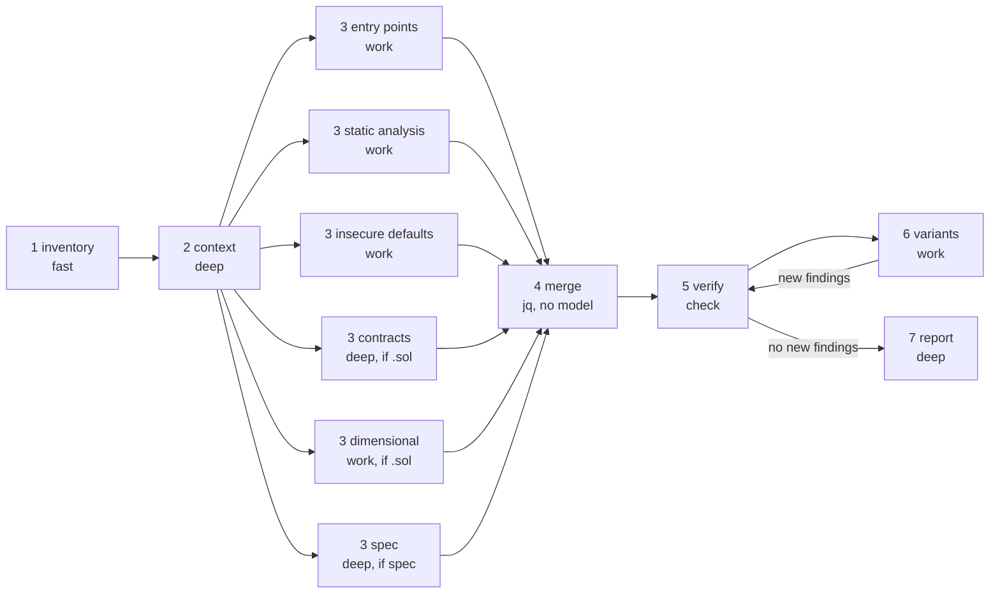

# auto-audit

Two shell scripts that run a staged security audit of a git repository with
[omp](https://github.com/can1357/oh-my-pi) agents, the
[Trail of Bits skills](https://github.com/trailofbits/skills), and the
[Cloudflare skills](https://github.com/cloudflare/skills).

Each audit stage is one non-interactive `omp -p` run. Each stage uses the model tier that its
work needs and loads only the skills that it uses. A stage writes files. A shell gate checks
those files before the next stage starts. Any failure stops the run.

## Install

```sh
./install.sh
```

`install.sh` does three things. You can run it again; it skips what is already in place.

1. It registers two omp plugin marketplaces from GitHub: `trailofbits/skills` and
   `cloudflare/skills`.
2. It installs 13 Trail of Bits plugins and the `cloudflare` plugin at user scope.
3. It installs the `semgrep` and `trailmark` CLIs with `uv tool install`.

Both marketplaces use the same mechanism, so `omp plugin upgrade` updates all plugins.

Requirements: `omp`, `uv`, `jq`, `envsubst` (gettext), `git`. For Solidity targets: `slither`.

## Run

```sh
./audit.sh <repo> [scope] [spec]
```

| Argument | Meaning |
|---|---|
| `repo` | Path to a git checkout |
| `scope` | Path inside the repo to audit. The default is the whole repo. |
| `spec` | Path inside the repo to a specification document. It enables the spec stage. |

The run directory is `.scratch/runs/<repo>-<UTC time>/`. Set `AUDIT_RUNS` to change the parent.
The final report is `report/REPORT.md` in the run directory.

## Run a whole repository in priority order

```sh
./audit-all.sh <repo> <triage-file> [max-components]
```

`audit.sh` audits one scope. `audit-all.sh` audits every component of a repository, highest
rank first, one at a time. You write the triage file: it decides what matters most.

```text
# kind | path | spec ("-" for none) | reason
component | contracts/src    | docs/spec.md | Holds user funds. Immutable after deploy.
component | services/api     | docs/spec.md | Internet-facing. Holds a funded key.
component | scripts          | -            | Operator tools. Not internet-facing.
exclude   | test             | -            | Tests. The stages read them as evidence.
exclude   | vendor/other-lib | -            | Separate project.
```

- Components are in rank order. Rank them by value at risk and exposure, not by size.
- Before any model runs, a gate checks that every tracked source file belongs to exactly one
  entry. The longest matching path wins, so a component can sit inside an excluded directory.
- `max-components` stops after that many components. The rest show as `not run`.
- A completed run with the same commit, scope, and spec is reused. After a failure (for
  example a rate limit), run the same command again: it continues with the failed component.
- `COVERAGE.md` in `.scratch/runs/<repo>-all-<UTC time>/` opens with the coverage line, for
  example "Audited 3 of 10 components: 1050 of 9600 source lines". It is rewritten after each
  component, so it is correct even when the run stops early.

Keep the triage file of a private repository outside this repository.

## Stages



| Stage | Skills | Tier | Writes |
|---|---|---|---|
| inventory | `trailmark-summary`, `supply-chain-risk-auditor` | fast | `INVENTORY.md`, `findings.jsonl` |
| context | `audit-context-building` | deep | `DOSSIER.md`, `functions/` |
| entry | `entry-point-analyzer` | work | `ENTRY_POINTS.md`, `findings.jsonl` |
| static | `semgrep`, `sarif-parsing` | work | `semgrep.sarif`, `findings.jsonl` |
| defaults | `insecure-defaults` | work | `findings.jsonl` |
| contracts | `secure-workflow-guide`, `token-integration-analyzer` | deep | `slither.txt`, `findings.jsonl` |
| dimensional | `dimensional-analysis` | work | `UNITS.md`, `findings.jsonl` |
| spec | `spec-to-code-compliance` | deep | `COMPLIANCE.md`, `findings.jsonl` |
| verify-N | `fp-check` | check | `verdicts.jsonl` |
| variants-N | `variant-analysis` | work | `findings.jsonl` |
| report | none | deep | `REPORT.md` |

The stage 3 passes run in parallel. The merge step gives each finding an id (`F1`, `F2`, …).

**Verification loop.** A model that found no issue (the `check` tier) tries to refute each
finding. The variant stage then searches for other instances of each confirmed finding. New
instances go back to verification. The loop stops when the variant stage finds no new instance,
or when verification confirms nothing. It does not stop after a fixed number of rounds. The cost
and time limits of each stage still apply, and a stage that reaches a limit fails the run.

## Model tiers

`tiers.env` sets the model and the cost limit for each tier. Environment variables override it.

| Tier | Default model | Used for |
|---|---|---|
| fast | `anthropic/claude-haiku-5-5` | Mechanical collection |
| work | `anthropic/claude-sonnet-5-5` | Most hunting passes, variants |
| deep | `anthropic/claude-opus-5-5` | Context, contracts, spec, report |
| check | `anthropic/claude-fable-5-1` | Independent verification |

Run `omp models anthropic` to see the model IDs that your omp can use.

## Gates

| Gate | Check |
|---|---|
| Every stage | `omp` exits 0, and the agent's last line is `DONE` |
| `findings.jsonl` | Each line is a JSON object with `title`, `severity`, `file`, `line`, `claim`, `evidence` (the merge drops other keys) |
| `DOSSIER.md` | Has `## Unenforced assumptions` and `## Open questions` |
| `verdicts.jsonl` | Exactly one valid verdict for each finding in the round |
| `REPORT.md` | Not empty |

## What a run records

`manifest.json` in the run directory holds the target commit, the count of uncommitted files,
the omp version, the models, the installed plugin versions, and the start time. Each stage
directory holds `transcript.txt`, the full output of its omp run.

## Limits

- Stages run with `--auto-approve`. The prompts tell each agent to write only in its stage
  directory, but nothing enforces this. Run audits on a checkout that you can discard.
- Some Trail of Bits skills route to Claude Code plugin workflows (`workflows/*.js`). omp loads
  plugin skills, commands and agents, but not those workflows. The shared stage rules tell the
  agent to do the workflow's work itself when the workflow is absent.
- CodeQL is not installed by `install.sh`.
- A stage that hits a provider rate limit (HTTP 429) fails the run. The run does not retry and
  has no resume: start it again after the time that the 429 response gives. The stage 3 passes
  run in parallel, so they use the most rate limit.

## Measured run

lcnc-claim, scope `services/relayer` (456 lines of JavaScript), spec
`specification/wallet-signing-bridge-v1.md`, default tiers:

| Stage | Time |
|---|---|
| inventory | 1 min 17 s |
| context | 17 min 49 s |
| hunting (entry, static, defaults, spec in parallel) | 6 min 4 s |
| verify, round 1 (22 findings, 17 confirmed) | 3 min 50 s |
| variants, round 1 (no new findings, so the loop ended) | 35 s |
| report | 3 min 35 s (the first attempt failed on a 429 rate limit and was rerun) |

The context stage takes most of the time. It analyzes each function in its own subagent.
